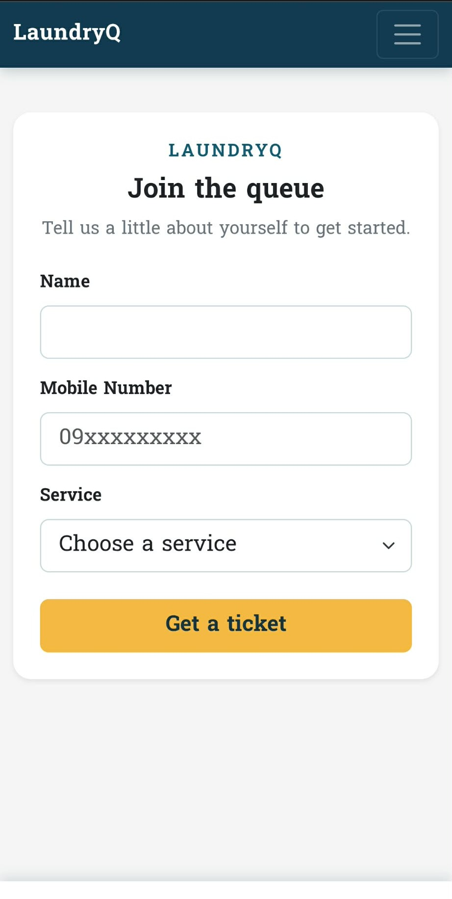
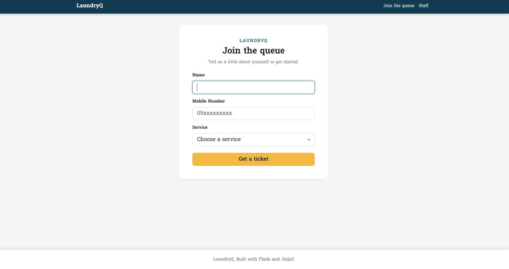
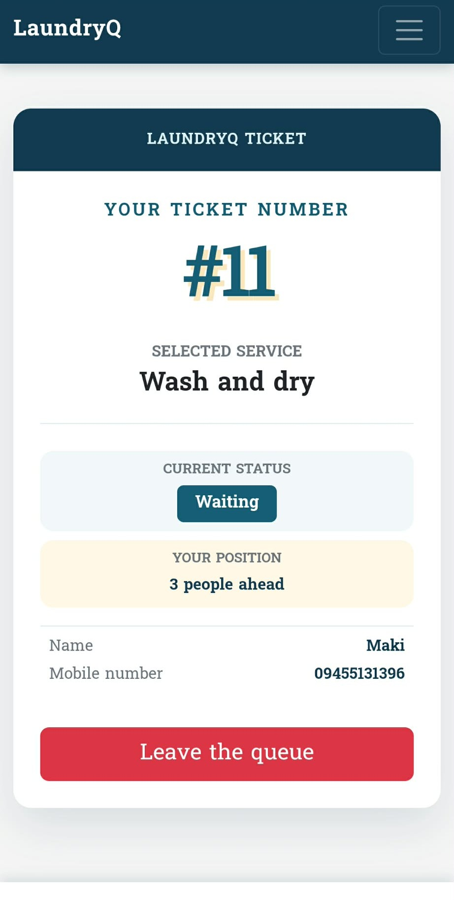
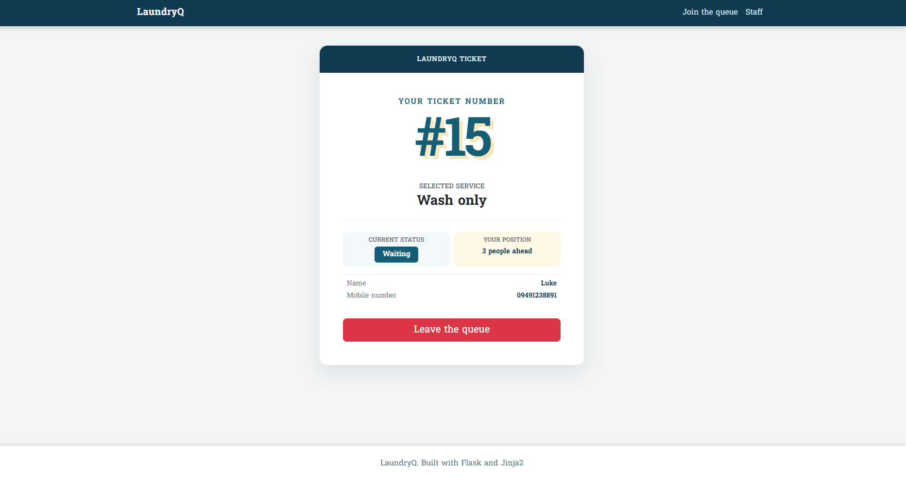
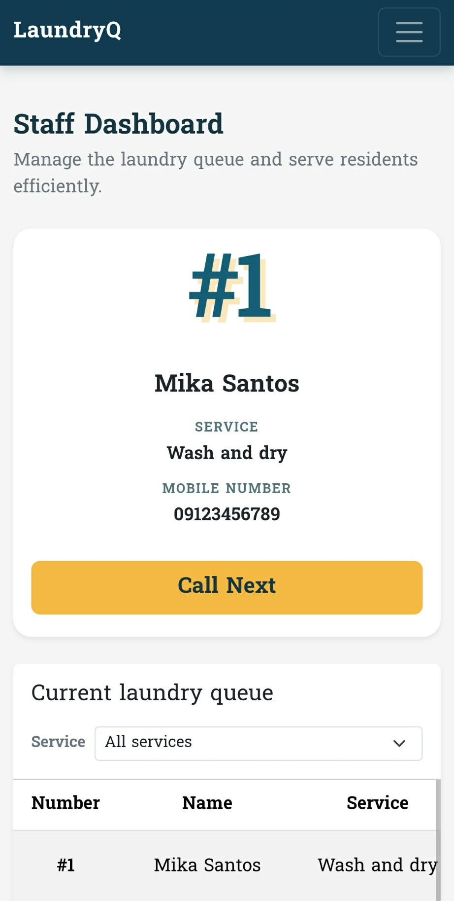
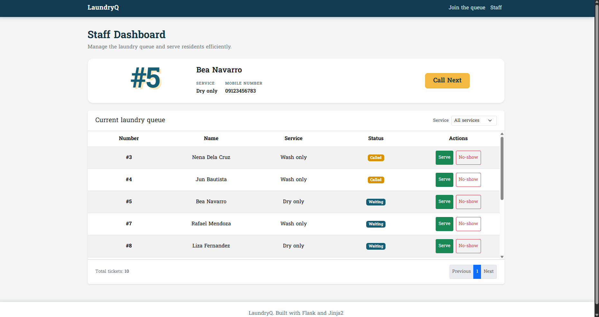

# LaundryQ Week 3 report

## Title details

- **App:** LaundryQ
- **Setting:** Dormitory laundry room queue
- **Full name:** Luke Ryan C. Ruaya
- **Student ID:** 2024-1557
- **Section:** CS3A
- **Date:** October 25, 2026
- **Pull request:** 

## Personas

- **Mika Santos, the person waiting:** A busy nursing student who needs a
  quick, lightweight way to join a laundry queue, see her position and wait,
  receive a visible alert, and leave the queue. Her quote is: “I come down
  with my basket and there are already six others on the floor, and nobody
  knows whose turn it is.” See [personas.md](personas.md).
- **Mang Ernie Dela Cruz, the staff member:** A laundry attendant who needs to
  keep a fair ordered queue, call the next person, remove no-shows, and mark
  people served while working with wet hands and older eyes. His quote is:
  “All day they ask me ‘Am I next? Am I next?’ while I'm trying to load and
  unload the machines.” See [personas.md](personas.md).

## Screens

### Join queue

Mika uses this screen to join a service queue and it covers **FR-01**.

### My place

Mika uses this screen to see her ticket, queue position, and current status;
it covers **FR-02, FR-03, and FR-04**.

### Staff dashboard

Mang Ernie uses this screen to see the ordered queue, call the next person,
remove no-shows, and mark people served; it covers **FR-05, FR-06, and FR-07**.

## Design decisions

1. I put the ticket number and position near the top of My place because Mika
   checks her phone while carrying a basket and needs the most important
   information without scrolling.
2. I kept Join the queue as a short form with large controls because Mika has
   limited time, often has one hand occupied, and should not need an account or
   sign-up.
3. I put Call Next in a prominent card above the queue table because Mang Ernie
   performs that action often and needs a large, high-contrast control on a
   shared tablet.

## Self-review

The self-review found that the Join queue service choices are hidden inside a
select, My place does not yet show estimated wait or a return deadline, and the
staff queue does not show arrival times. These issues are documented in
[feedback.md](feedback.md). The layout was kept lightweight and readable rather
than adding more visual density, while the ticket status remains visible in
words and the staff queue keeps its responsive table behavior.

## Accessibility

The Lighthouse accessibility score improved from **82–84** to **90–92** after
using minimized Bootstrap assets. Keyboard-only navigation was verified on all
three screens. The most important accessibility issue fixed was the Staff
dashboard heading hierarchy: it had two `<h1>` elements, so the next ticket
name was changed to `<h2>`. Action buttons, pagination links, and the mobile
navigation toggle were also brought to approximately 44px touch height.
Details are in [accessibility.md](accessibility.md).

## Usability test

The participant completed all three tasks without help in about **1 minute and
20 seconds**:

1. Joining a service took about 24 seconds with no hesitation.
2. Finding the number and people ahead took about 8 seconds with no hesitation.
3. Calling and serving took about 43 seconds; the participant hesitated at the
   table's Serve action because Call Next is located in a separate card.

The one improvement was changing **Serve** to **Mark as served**. Before the
fix, the action wording did not match the task language closely enough. After
the fix, the action explicitly states the intended result and matches its
ticket-specific accessible label. See [usability-test.md](usability-test.md).

## Reflection

The hardest part this week was balancing a fast staff workflow with a compact,
readable responsive layout. The test showed that even a familiar short label
can cause hesitation when related actions are separated across the screen.

When the data moves to a database in Week 4, I will store ticket creation time
so the staff queue can show arrival times and preserve a verifiable order. I
will also add server-backed estimated wait data and a reliable notification
state so My place can show the wait and return deadline that Mika needs.

## Declaration

Select one option:

- [ ] No generative AI tools were used by any member in preparing this submission.
- [x] One or more members used generative AI tools. Details are provided below.

**Tool used**: ChatGPT 5.6 Luna

**Purpose**: Help brainstorm in making the personas for the laundry queue app, debugging whenever errors occurred, css media controls (for mobile view), and help on making markdown reports.

**How output was checked or revised**: Checked for any persona scope that is outside my reach or hard to attain, used real data and let the AI format and how to display it in a clean way. Revised any code that looks complex or a code that I can not replicate without AI and wrote them in my own style.
