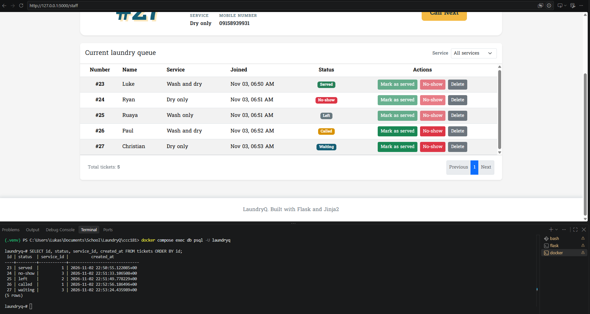
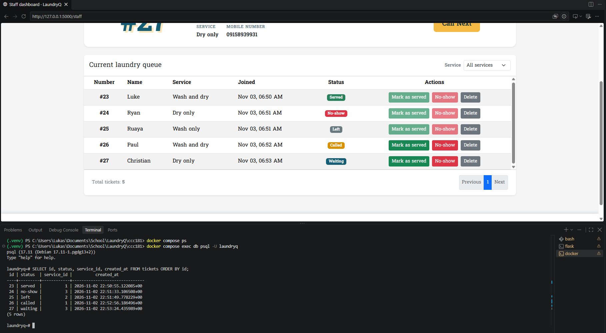
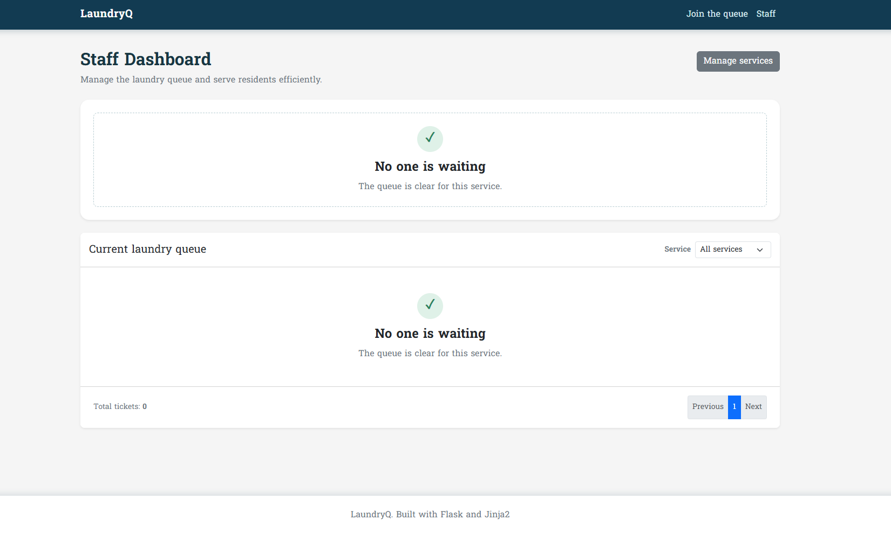

# Part 11: Persistence evidence

LaundryQ uses PostgreSQL through SQLAlchemy and Flask-Migrate. The following
tests document that queue history survives a database restart and that the
database can be rebuilt from the migration.

## 11a. Restart test

The test was performed in this order:

1. Created five tickets across the Wash and dry, Wash only, and Dry only
   services.
2. Called ticket 26, served ticket 23, and let ticket 25 leave the queue.
   Ticket 24 was marked no-show and ticket 27 remained waiting.
3. Captured the staff dashboard and ran:

   ```sql
   SELECT id, status, service_id, created_at
   FROM tickets
   ORDER BY id;
   ```

   

4. Stopped Flask with Ctrl+C, ran `docker compose down`, and checked
   `docker compose ps`. No containers were running.
5. Ran `docker compose up -d` and waited for the database health check to
   report healthy.
6. Started Flask again, opened the staff dashboard, and ran the same SQL
   query.

   

The five ticket IDs, statuses, service IDs, and `created_at` values are the
same before and after the restart. This demonstrates that the records are
persisted in PostgreSQL rather than stored in Flask process memory.

## 11b. Rebuild from scratch

After the restart test, the database was rebuilt with:

```text
docker compose down -v
docker compose up -d
flask --app app db upgrade
flask --app app seed
```

The migration completed, the seed command restored the three services, and the
application opened successfully. The join form displayed the seeded services
and accepted a new ticket. The post-rebuild application state is shown here:



The rebuild confirms that `migrations/versions/502f5ea14eff_initial_tables.py`
creates the complete `users`, `services`, and `tickets` schema. Daily
development uses plain `docker compose down`; `down -v` is reserved for an
intentional clean rebuild because it deletes database data.

## Result

NFR-01 passed: no active ticket or service was lost when the application and
database restarted. The migration also rebuilt the database successfully from
scratch.
