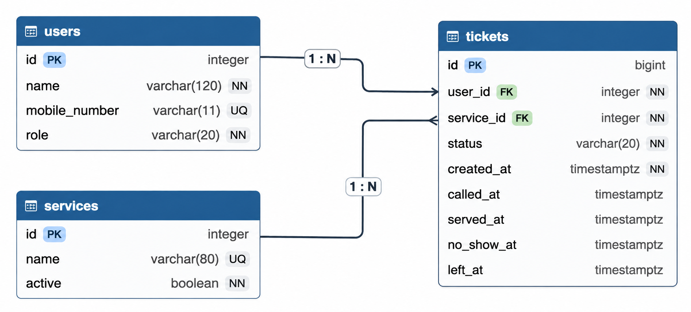

# LaundryQ Week 4 report

## Title details

- **App:** LaundryQ
- **Setting:** University dormitory laundry room
- **Full name:** Luke Ryan C. Ruaya
- **Student ID:** 2024-1557
- **Section:** CS3A
- **Date:** 3 November 2026
- **Pull request:** [#4](https://github.com/vyleene/ccc181/pull/4)

## Requirements

I wrote 12 functional requirements and 5 non-functional requirements. The
MVP includes joining and tracking a queue, the staff queue workflow, service
management, persistence, integrity, performance, accessibility, and security.
The complete list is in [docs/requirements.md](../requirements.md).

The person waiting in the setting said they needed to know roughly when their
turn would come so they could return to their room and study. I queue position 
part of FR-02. A second review emphasized fair orderand each person's service, 
so the staff queue shows ticket order, names, services, and statuses.

## ERD



One user can have many tickets. One service can have many tickets. Each ticket
belongs to exactly one user and one service. The ticket foreign keys use
`ON DELETE RESTRICT` so historical queue records cannot be orphaned.

See the full schema explanation in [docs/week4/schema.md](schema.md).

## Schema

The database contains three tables. The following is the table-definition
output represented by the PostgreSQL schema used by the migration:

```text
                 Table "public.users"
     Column      |         Type          | Nullable |                Default
-----------------+-----------------------+----------+--------------------------------------
 id              | integer               | not null | generated always as identity
 name            | character varying(120)| not null |
 mobile_number   | character varying(11) |          |
 role            | character varying(20) | not null | 'resident'
Indexes:
    "users_pkey" PRIMARY KEY, btree (id)
    "users_mobile_number_key" UNIQUE CONSTRAINT, btree (mobile_number)
Check constraints:
    "ck_users_mobile_number"
    "ck_users_resident_mobile_number"
    "ck_users_role"

                 Table "public.services"
 Column |         Type          | Nullable |                Default
--------+-----------------------+----------+--------------------------------------
 id     | integer               | not null | generated always as identity
 name   | character varying(80) | not null |
 active | boolean               | not null | true
Indexes:
    "services_pkey" PRIMARY KEY, btree (id)
    "services_name_key" UNIQUE CONSTRAINT, btree (name)

                 Table "public.tickets"
    Column    |           Type           | Nullable |                Default
--------------+--------------------------+----------+--------------------------------------
 id           | bigint                   | not null | generated always as identity
 user_id      | integer                  | not null |
 service_id   | integer                  | not null |
 status       | character varying(20)  | not null | 'waiting'
 created_at   | timestamp with time zone | not null | now()
 called_at    | timestamp with time zone |          |
 served_at    | timestamp with time zone |          |
 no_show_at   | timestamp with time zone |          |
 left_at      | timestamp with time zone |          |
Indexes:
    "tickets_pkey" PRIMARY KEY, btree (id)
Foreign-key constraints:
    "tickets_service_id_fkey" FOREIGN KEY (service_id)
        REFERENCES services(id) ON DELETE RESTRICT
    "tickets_user_id_fkey" FOREIGN KEY (user_id)
        REFERENCES users(id) ON DELETE RESTRICT
Check constraints:
    "ck_tickets_status"
```

## Design decisions

1. I kept residents, services, and tickets in separate tables because FR-01
   and FR-05 need resident and service details without copying them into every
   ticket.
2. I used an identity-generated `tickets.id` because NFR-02 requires unique
   ticket numbers even when residents join at the same time.
3. I used `ON DELETE RESTRICT` for ticket references because FR-09 needs old
   ticket history for service reports. Services can be switched off instead
   of deleting their history.

## Self-review

The main issue found in the schema review was that event timestamps and
statuses could become inconsistent if an update changed only one of them.
The application now updates the status and its event timestamp in the same
database transaction. The review also confirmed that queue position should be
computed from `created_at`, not stored as a value that could become stale.

See [docs/week4/schema-review.md](schema-review.md).

## Migrations

- `502f5ea14eff_initial_tables.py` creates the `services`, `users`, and
  `tickets` tables, including identity keys, defaults, checks, unique
  constraints, and restricted foreign keys.

## CRUD

| Operation | Route | Requirement | Evidence |
| --- | --- | --- | --- |
| Create ticket | `POST /join` | FR-01 | The resident join flow creates a user and ticket. |
| Read queue | `GET /staff` | FR-05 | [Dashboard screenshot](screenshots/persistence_check_before.png) |
| Update service | `POST /staff/services/<service_id>/edit` | FR-08 | Staff can rename or switch a service off. |
| Soft delete ticket | `POST /queue/<ticket_id>/leave` | FR-04 | The ticket remains in history with status `left`. |
| Hard delete ticket | `POST /staff/tickets/<ticket_id>/delete` | Staff queue maintenance | Staff can explicitly delete a ticket record. |

The dashboard screenshot shows the persisted read state, including served,
no-show, left, called, and waiting tickets. Service create/edit/delete actions
are implemented in [app.py](../../app.py).

## Validation

Browser attributes reject missing values and malformed mobile numbers quickly.
Flask then validates requests that bypass the browser, returning `400` without
creating a ticket. PostgreSQL enforces foreign keys, unique mobile numbers,
allowed statuses, non-null fields, and restricted deletes.

The most useful database error was:

```text
update or delete on table "services" violates foreign key constraint
"tickets_service_id_fkey" on table "tickets"
```

It proves that deleting a service cannot silently destroy the ticket history
needed for reporting. Full evidence is in
[docs/week4/validation.md](validation.md).

## Persistence

The before-and-after restart evidence is documented in
[docs/week4/persistence.md](persistence.md):

- [Before restart](screenshots/persistence_check_before.png)
- [After restart](screenshots/persistence_check_after.png)
- [After rebuild](screenshots/persistence_check_rebuild.png)

The five tickets retained their IDs, statuses, service IDs, and timestamps
after the restart. The database also rebuilt from the migration, the seed
command restored the services, and the app accepted a new join. NFR-01
passed.

## Reflection

The hardest part this week was implementing a notification system since it
was needed for FR-03, after researching possible ways, I decided to utilize 
the browser's native notifications API `new Notifications()`. My place already 
calls `status.json` every 10 seconds to update the status badge, I just included
the notification to be called with it.

A report the staff persona would want is: “How many people left before being
served, per service, per day?” The stored `left_at`, `service_id`, and status
fields support that Week 5 report.

## Declaration

Select one option:

- [ ] No generative AI tools were used by any member in preparing this submission.
- [x] One or more members used generative AI tools. Details are provided below.

**Tool used**: ChatGPT 5.6 Luna

**Purpose**: Help structuring markdowns, debug checks, code refactoring. Brainstorm functional
and non-functional requirements.

**How output was checked or revised**: Checked for any requirements that are beyond my capabilities
and scope, reviewed the code for any inconsistencies and whether it is something I am capable of
with enough time.
