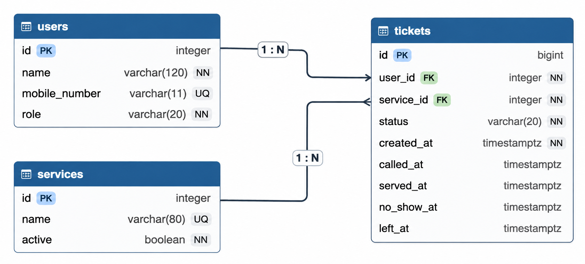

# LaundryQ database schema

## 2a. Nouns in the requirements

| Req ID | Requirement | Nouns | Table or column? |
| --- | --- | --- | --- |
| FR-01 | A **resident** can join a **queue** for a specific **laundry service** by entering their **name** and **mobile number**. | resident, queue, laundry service, name, mobile number | `users`, not a table, `services`, `users.name`, `users.mobile_number` |
| FR-02 | A resident can see their **ticket number**, current **status**, and how many people are **ahead** of them. | ticket number, status, ahead | `tickets.id`, `tickets.status`, computed |
| FR-03 | A resident can receive a visible **alert** when they are called. | alert, notification delivery, called ticket | `tickets.called_at`; visible delivery is application behavior |
| FR-04 | A resident can leave the queue before being served. | resident, queue, ticket status | `users`, computed queue, `tickets.status` |
| FR-05 | A staff member can see the active queue in ticket order, including each resident's **name**, laundry **service**, and **status**. | staff member, queue, name, service, status | `users`, computed queue, `users.name`, `services`, `tickets.status` |
| FR-06 | A staff member can call the next waiting resident for the selected laundry service. | staff member, ticket, service, called time | `users`, `tickets`, `tickets.service_id`, `tickets.called_at` |
| FR-07 | A staff member can mark a called ticket as **served** or **no-show**. | staff member, ticket, served, no-show | `users`, `tickets.status`, `tickets.served_at`, `tickets.no_show_at` |
| FR-08 | A staff member can add, rename, and switch off a laundry **service**. | staff member, service, name, active state | `users`, `services.name`, `services.active` |
| FR-09 | A staff member can see how many residents left before being served, per service and per day. | staff member, resident, service, day, leave event | `users`, `services`, `tickets.status`, `tickets.left_at`; computed report |
| FR-12 | A resident can receive a confirmation containing their ticket number after joining the queue. | resident, confirmation, ticket number | `users`, `tickets.id`; confirmation is generated by the application |

## 2b. Tables and columns

| Table | Columns |
| --- | --- |
| `users` | `id`, `name`, `mobile_number`, `role` |
| `services` | `id`, `name`, `active` |
| `tickets` | `id`, `user_id`, `service_id`, `status`, `created_at`, `called_at`, `served_at`, `no_show_at`, `left_at` |

## 2c. Column types and constraints

| Table | Column | PostgreSQL type | Constraint | Why |
| --- | --- | --- | --- | --- |
| `users` | `id` | `integer GENERATED ALWAYS AS IDENTITY` | PRIMARY KEY | Gives every person a stable database identifier. |
| `users` | `name` | `varchar(120)` | NOT NULL | A resident or staff member must have a display name. |
| `users` | `mobile_number` | `varchar(11)` | UNIQUE, CHECK (mobile number is NULL or matches `09` followed by 9 digits) | Stores a resident contact without losing its leading zero; staff do not need a mobile number to manage the queue. |
| `users` | `role` | `varchar(20)` | NOT NULL, DEFAULT `'resident'`, CHECK (role IN (`'resident'`, `'staff'`)) | Restricts people to supported application roles. |
| `services` | `id` | `integer GENERATED ALWAYS AS IDENTITY` | PRIMARY KEY | Gives every laundry service a stable identifier. |
| `services` | `name` | `varchar(80)` | NOT NULL UNIQUE | Prevents duplicate service names when staff manage services. |
| `services` | `active` | `boolean` | NOT NULL DEFAULT `true` | Allows staff to switch a service off without deleting its history. |
| `tickets` | `id` | `bigint GENERATED ALWAYS AS IDENTITY` | PRIMARY KEY | Provides a unique, never-reused ticket number. |
| `tickets` | `user_id` | `integer` | NOT NULL, FOREIGN KEY REFERENCES `users(id)` | Connects each ticket to the resident who joined. |
| `tickets` | `service_id` | `integer` | NOT NULL, FOREIGN KEY REFERENCES `services(id)` | Prevents a ticket from referring to a missing service. |
| `tickets` | `status` | `varchar(20)` | NOT NULL DEFAULT `'waiting'`, CHECK (status IN (`'waiting'`, `'called'`, `'served'`, `'no-show'`, `'left'`)) | Allows only known queue states. |
| `tickets` | `created_at` | `timestamptz` | NOT NULL DEFAULT `now()` | Stores the time the resident joined and preserves fair ordering across time zones. |
| `tickets` | `called_at` | `timestamptz` | NULL | Records when staff called the resident. |
| `tickets` | `served_at` | `timestamptz` | NULL | Records when the service was completed. |
| `tickets` | `no_show_at` | `timestamptz` | NULL | Records when staff marked the resident as a no-show. |
| `tickets` | `left_at` | `timestamptz` | NULL | Records when the resident left before being served. |

## 2d. ERD

One user has many tickets. One service has many tickets. Each ticket belongs
to exactly one user and one service. The foreign keys use `ON DELETE RESTRICT`.

| Foreign key | On parent delete | Reason |
| --- | --- | --- |
| `tickets.user_id` → `users.id` | `RESTRICT` | Do not delete a resident while their tickets are retained for queue history and reports. |
| `tickets.service_id` → `services.id` | `RESTRICT` | Do not delete a service while old tickets are retained for service reports. |

## 2e. Normalization check

1. **One value per cell (1NF):** Yes. Each column stores one atomic value:
   one name, one mobile number, one role, one service reference, one status, or
   one timestamp. No column stores a list such as `"Wash and dry, Wash only"`;
   a ticket selects one service through `service_id`.
2. **Depends on the whole key (2NF):** Yes. There are no join tables with
   composite keys in this schema. The only relationships are the
   `tickets.user_id` and `tickets.service_id` foreign keys, and every ticket
   attribute describes the whole ticket identified by `tickets.id`.
3. **No hidden copies (3NF):** Yes. A person's name and mobile number appear
   only in `users`, and a service's name and active state appear only in
   `services`. Tickets store only their foreign keys, so changing a resident's
   details or a service name requires one update rather than updates across
   multiple ticket rows.

The schema is normalized to 3NF. No column needs to be split into another
table, and no duplicate fact needs a second stored copy.